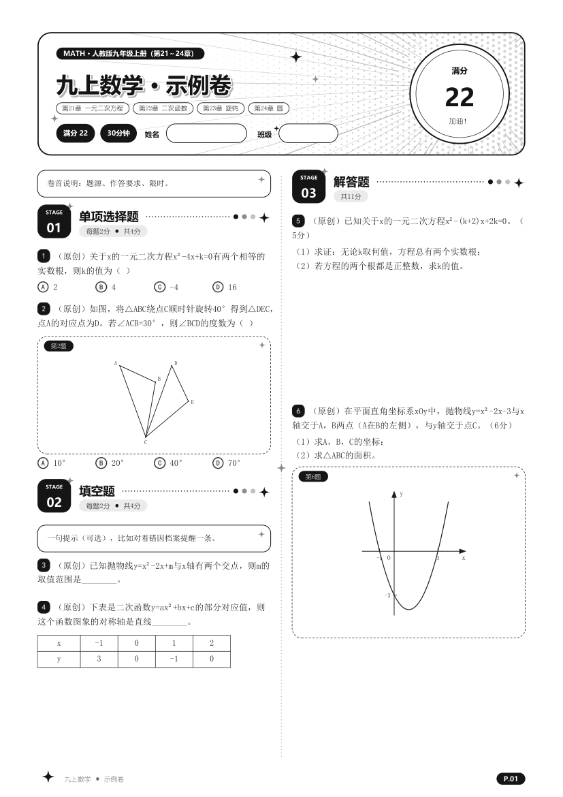
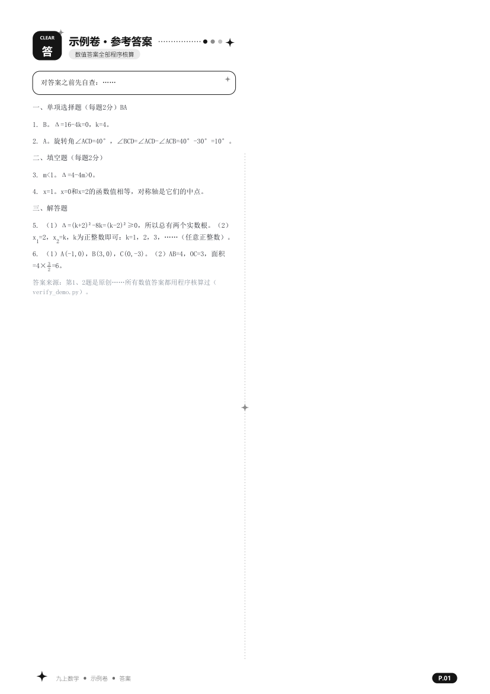

# exam-paper-kit

一个出卷 skill：从定范围、按题位选题、写出卷脚本、按题干条件画图、程序验算答案，到两栏排版、去空白、交付前检查，
出**可以直接打印**的初中数学试卷——A4 两栏、黑白卡片风格，试卷和答案各一个 PDF。

用的是通用的 SKILL.md 格式，**Claude Code、Codex、WorkBuddy、CodeBuddy、TRAE、Qoder** 等支持 skill 的 AI 工具都能装；
不支持 skill 的工具，让它直接读 `skills/exam-paper/SKILL.md` 照做也行。附带的排版引擎不用 AI 也能直接写 Python 出卷。

<p>


</p>

（图里是 `examples/` 里的示例卷，题目是原创的。）

## 安装

### 最省事：把下面这段话直接丢给你的 AI

```text
请帮我安装 exam-paper 这个出卷 skill，仓库是 https://github.com/lxy3312/exam-paper-kit 。
1. 把仓库下载到本地（git clone https://github.com/lxy3312/exam-paper-kit.git ；没有 git 就下载 ZIP 解压）。
2. 确认电脑上有 Python 3.10 以上，然后在仓库目录里运行：
   python install.py --tool <你自己>
   Claude Code 填 claude，Codex 填 codex，WorkBuddy 填 workbuddy，CodeBuddy 填 codebuddy，TRAE 填 trae，Qoder 填 qoder；
   不在这个列表里的，用 --dest 指定你读取 skill 的目录。
   这个脚本会把 skills/exam-paper 复制到对应目录、装好 Python 依赖、再跑一份示例卷检查能不能用。
3. 告诉我 skill 装到了哪个目录、示例卷有没有生成成功；如果需要重启你自己才能加载新 skill，提醒我重启。
4. 如果示例卷报找不到中文字体，按仓库 README 里「字体」一节处理，不要跳过。
```

### 自己动手

1. 下载：`git clone https://github.com/lxy3312/exam-paper-kit.git`，或者在 GitHub 页面点 **Code → Download ZIP** 解压。
2. 在仓库目录运行安装脚本（只用标准库，Windows / macOS / Linux 都能跑）：

   ```bash
   python install.py --tool claude                # 换成你用的工具，可以写多个 --tool
   ```

   常用参数：`--tool all` 所有工具都装；`--dest 目录` 装到指定的 skills 目录；`--project .` 装到当前项目里；
   `--force` 覆盖已有的同名 skill；`--no-deps` 不装依赖；`--no-test` 不跑示例卷。

3. 不想用脚本，也可以手动把 `skills/exam-paper` 整个文件夹复制到下表的目录，再 `pip install -r requirements.txt`：

| 工具 | 用户级目录（所有项目都能用） | 项目级目录 | 备注 |
|---|---|---|---|
| Claude Code | `~/.claude/skills/` | `.claude/skills/` | |
| Codex | `~/.agents/skills/` | `.agents/skills/` | 老版本用 `~/.codex/skills/` |
| WorkBuddy | `~/.workbuddy/skills/` | — | 放好以后重启 WorkBuddy |
| CodeBuddy | `~/.codebuddy/skills/` | `.codebuddy/skills/` | |
| TRAE | `~/.trae/skills/` | `.trae/skills/` | |
| Qoder | `~/.qoderwork/skills/` | `.qoderwork/skills/` | |

`~` 是用户目录（Windows 上是 `C:\Users\你的用户名`）。路径以各家最新文档为准；装完 skill 没出现，就查一下工具文档里的 skills 目录，再用 `--dest` 装过去。

### 字体

排版要中文 TrueType 字体。Windows 自带的宋体、黑体、微软雅黑、幼圆就够了，不用另外装。
macOS / Linux 用环境变量指到字体文件：`EXAM_PAPER_FONT_BODY`（正文，宋体类）、`EXAM_PAPER_FONT_HEAD`（标题，黑体类）。
ReportLab 不支持 CFF 轮廓的 OTF（比如 Noto CJK 的 `.otf`），要用 `.ttf` 或 TrueType 轮廓的 `.ttc`。

## 怎么用

装好以后直接跟 AI 说就行，比如：

> 用 exam-paper 出一份人教版九上期中数学卷，100 分，超难，试卷和答案分开。

| 工具 | 手动调用 |
|---|---|
| Claude Code | `/exam-paper`，或者直接描述需求让它自动选中 |
| Codex | `$exam-paper`，或者在 skills 面板里选 |
| WorkBuddy 等 | 直接描述需求；也可以说「用 exam-paper 这个技能」 |

AI 会按 SKILL.md 里的七步走：定范围和结构 → 按题位选题 → 从模板写出卷脚本 → 按题干条件画图 → 程序验算 →
模拟排版找最省空白的顺序 → 出试卷和答案两个 PDF 并检查。原卷（期中、一模、中考的 PDF 或照片）要你自己准备好给它。

不用 AI，直接跑示例：

```bash
cd examples
python build_demo.py      # 出 outputs/数学示例卷.pdf 和 outputs/数学示例卷（答案）.pdf
python verify_demo.py     # 答案验算
python ../skills/exam-paper/scripts/check_pdf.py outputs/数学示例卷.pdf --png png --montage png
```

## 里面有什么

```
skills/exam-paper/        ← 整个文件夹就是 skill，复制到工具的 skills 目录就能用
├── SKILL.md              出卷流程（七步）
├── reference/            卷面规矩清单、技术上的坑、题源和难题题位
├── kit/                  排版引擎
│   ├── layout.py         两栏版面、字体、公式（A÷B、√X 自动画成真分数线/真根号）、作答留白
│   ├── skin.py           横幅（分数印章）、关卡式章节头、图卡、题号徽章、选项字母、页面装饰、水印
│   ├── skin_q.py         不拆的整块（放不下先缩图再换栏）、中文断行禁则、填空横线
│   ├── paper_kit.py      题目按 id 存、题号按位置自动给、选择/填空/大题、出试卷和答案两个 PDF
│   ├── geometry.py       几何作图（Fig 自然坐标自动缩放、Coord 网格坐标系）
│   ├── figkit.py         坐标系、弧、圆上标签、几张小图拼一行
│   └── contact_sheet.py  把一个模块里的图拼成一张总览图
├── scripts/
│   ├── packsim.py        模拟两栏排版，找栏底空白最少的题目顺序
│   ├── reorder.py        按 id 重排题目列表
│   ├── check_pdf.py      量每栏栏底空白、查行首标点和水印、导出总览图
│   ├── lint_markup.py    出 PDF 前查会排坏的公式写法和缺字形的符号
│   ├── used_sources.py   列出以前的卷子用过哪些原题
│   └── crop.py           从原卷裁一道题出来看
└── templates/            出卷、配图、验算三个模板
examples/                 用模板做的示例卷，可以直接跑
install.py                安装脚本
AGENTS.md                 给 AI 工具看的仓库说明
```

几个设计上的取舍：

- **题干和图、题干和选项绝不拆开**；大题的作答留白可以流到下一栏，备用图可以单独流动。宁愿留空也不拆，留空再靠调顺序补。
- **题号按位置生成**：题目按 id 存，调顺序只挪列表条目，卷面题号、图注里的「第N题」、答案页全跟着变。
- **图由题干条件算出来**：`*_points()` 返回的点同时给画图、验算、审计用，图和答案对得上。
- **作答区只留白不画线**，分式一律真分数线，卷面不出现 `/` 和 `^`。

## 环境变量

| 变量 | 作用 | 默认 |
|---|---|---|
| `EXAM_PAPER_KIT` | 模板去哪儿找 `kit/` | 当前目录往上的各家 skills 目录，再到用户目录（示例里是仓库内的相对路径） |
| `EXAM_PAPER_OUT` | PDF 输出目录 | 当前目录下的 `outputs/` |
| `EXAM_PAPER_CACHE` | 公式小图缓存 | `~/.cache/exam-paper-kit` |
| `EXAM_PAPER_FONT_BODY` / `EXAM_PAPER_FONT_HEAD` | 正文 / 标题字体文件 | Windows 宋体 / 黑体 |

## 说明

- 仓库里没有任何原卷、扫描件或题库。用公开考试题出卷时，题源自己准备，遵守来源网站的条款和当地规定。
- 卷面格式默认按北京初三数学（单选 8×2、填空 8×2、解答 12 道），换地区、换学科照着改结构就行。
- 不含任何现成作品的人物或漫画。

## License

[MIT](LICENSE)
